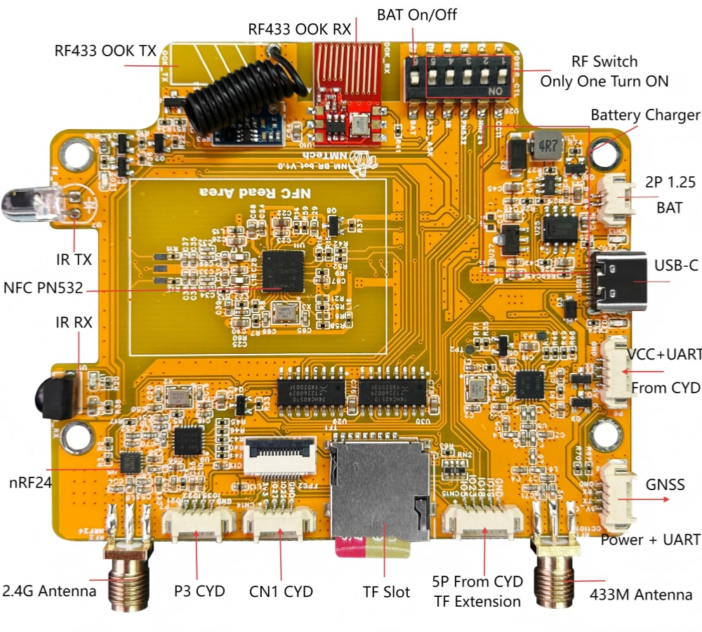

# NM-RF-HAT FAQ - Common Questions & Answers

## 📌 Product Overview

### Q1: What is the NM-RF-HAT?

The NM-RF-HAT is a multi-functional Radio Frequency (RF) expansion board specifically designed for the **ESP32-2432S028** / **NM-CYD-C5**, commonly known as the "Cheap Yellow Display" or CYD. It supports Bruce firmware, ESP32Marauder, and other open-source RF projects. By integrating multiple commonly used RF modules onto a single compact PCB, it solves the complex wiring and pin conflict issues commonly encountered in traditional development.

### Q2: What RF modules does the NM-RF-HAT support?

- CC1101: 433MHz FSK/GFSK | Remote control analysis, Sub-GHz analysis and replay
- nRF24L01: 2.4GHz | Wireless protocol analysis (mice, keyboards, etc.)
- PN532: NFC/RFID | High-frequency RFID read/write, card emulation
- IR: Infrared TX/RX | Infrared signal capture and replay
- RF433: 433MHz OOK/ASK | Simple 433MHz signal transmission

## ⚙️ Configuration & Usage
### Q3: How to set the DIP switch?

The NM-RF-HAT uses a 6-position DIP switch:
- Position 1 ON: Select CC1101 (433M)
- Position 2 ON: Select nRF24
- Position 3 ON: Select PN532 (RFID/NFC)
- Position 4 ON: Select IR Infrared
- Position 5 ON: Select RF433 (OOK/ASK)
- Position 6 ON: Battery power switch

⚠️ Note: Only one function switch ( RF 1-5) can be set to ON at any given time. Multiple modules cannot be active simultaneously.

### Q4: How to configure modules with Bruce firmware?

- CC1101: Set DIP to position 1 → RF → Config → RF Module → CC1101
- nRF24: Set DIP to position 2 → Select NRF24 functions (Spectrum, Jammer, etc.)
- PN532 NFC: Set DIP to position 3 → RFID → Config → RFID module → Choose PN532 on I2C
- RF433 OOK/ASK: Set DIP to position 5 → RF → Config → RF Module → M5 RF433T/R; Return to Config → RF TX Pin → M5 Pin 22; RF RX Pin → M5 Pin 27
- IR: Set DIP to position 4 → Config → IR TX Pin → Pin 22; IR RX Pin → Pin 27

### Q5: How to configure GPS?

Connect the GPS module first, then select GPS (note: default pins for official firmware are RX=22 TX=27, for NM-RF-HAT change to RX=1 TX=3), and choose `GPS Tracker` or `Wardriving` function.

## 🔧 Common Problems & Solutions

### Q6: Type-C port won't power on, indicator light stays off?

This is a known issue. Some CYD devices with Type-C interface cannot be powered using USB-C to USB-C cables.  

**Solution**: Replace with a USB-A to USB-C cable.

### Q7: How to identify a CYD with NMMiner Logo?

ESP32-2432S028 purchased from the NMTech website or AliExpress Global store all come with the NMMiner Logo and pre-flashed with firmware compatible with the ST7789 driver.

## 📞 Further Help
- Bruce Wiki: https://wiki.bruce.computer/
- NMTech Homepage: https://www.nmminer.com
- Telegram: https://t.me/NMMiner
- Reddit: https://www.reddit.com/r/NMTech_Team/
- Email: nmminer1024@gmail.com