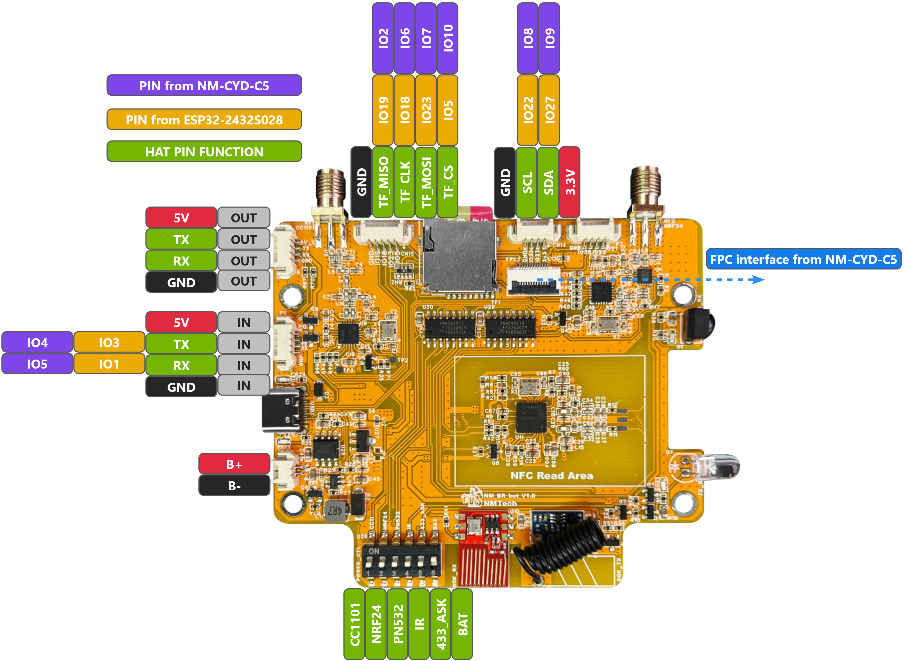
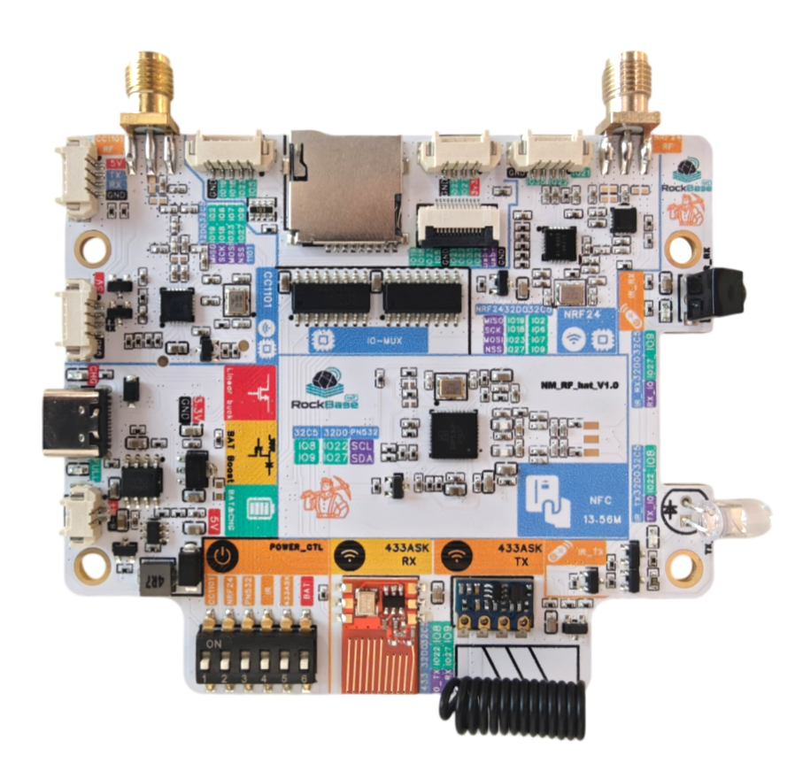
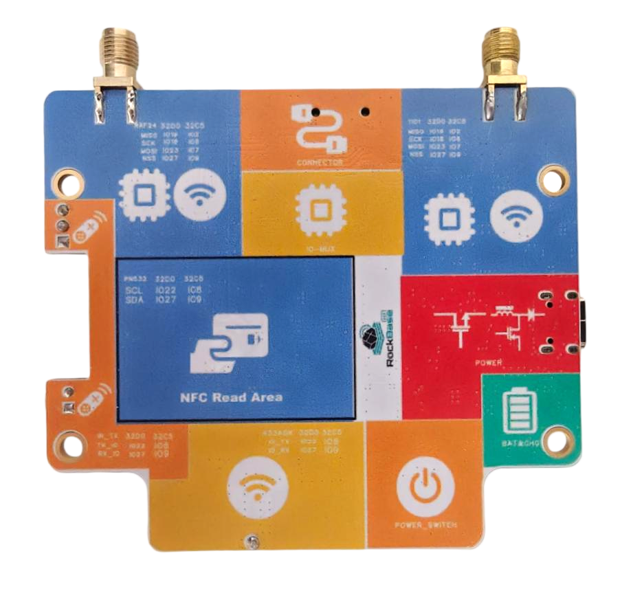
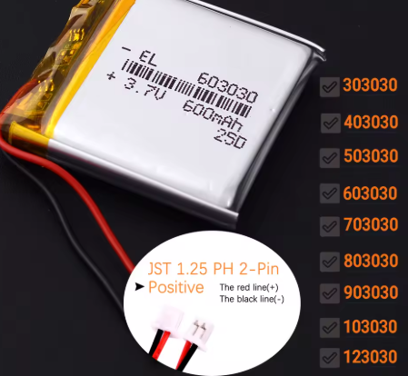

# NM-RF-HAT 

English | [简体中文](README_zh.md)

**A Multi-functional RF Expansion Board for ESP32-2432S028 (Cheap Yellow Display, CYD) and NM-CYD-C5**

The NM-RF-HAT is a multi-functional Radio Frequency (RF) expansion board specifically designed for the ESP32-2432S028, commonly known as the "Cheap Yellow Display" or CYD. This repository aims to provide hardware design files, documents and related resources for the NM-RF-HAT, supporting developers and enthusiasts in RF experimentation and project development.

## Project Overview

The primary goal of the NM-RF-HAT is to simplify the process of RF project development and experimentation by integrating multiple commonly used RF modules onto a single, compact PCB. It effectively addresses the challenges of complex wiring and potential pin conflicts often encountered in traditional development, offering an efficient and integrated hardware solution for various RF applications.

This expansion board is particularly well-suited for projects utilizing firmware such as [BruceDevices](https://github.com/BruceDevices/firmware), [HaleHound-CYD](https://github.com/JesseCHale/HaleHound-CYD) and [ESP32Marauder](https://github.com/justcallmekoko/ESP32Marauder), significantly enhancing the functionality and ease of use of these open-source tools.

The NM-RF-HAT board already supports ESP32-2432S028 devices and our [NM-CYD-C5](https://github.com/RockBase-iot/NM-CYD-C5) board.

### RockBase Colorful Version

The RockBase Colorful Version of the NM-RF-HAT features a distinctive color scheme for easier identification of different modules and connections. This version maintains all the functionalities of the standard NM-RF-HAT while providing a visually enhanced experience for developers and enthusiasts. *Note: The Colorful Version is identical to the standard version in functionality and pinout; only the appearance differs.*

## Key Features

The NM-RF-HAT integrates a variety of popular RF modules, providing extensive wireless communication capabilities:

*   **Multi-Band RF Support:**
    *   **CC1101:** Sub-1 GHz transceiver for applications like remote control devices.
    *   **nRF24L01:** 2.4 GHz transceiver supporting custom protocols and wireless communication.
    *   **PN532:** NFC/RFID module for reading and writing near-field communication tags.
    *   **IR:** Infrared transmitter and receiver for infrared remote control applications.
    *   **RF433:** 433MHz ASK (Amplitude Shift Keying) transmitter/receiver module.
*   **Power Management:** On-board power management features, supporting battery charging and discharging to ensure stable power supply.
*   **GNSS Expansion Interface:** Provides an interface for connecting Global Navigation Satellite System (GNSS) modules, supporting positioning functions.
*   **TF Card Slot:** For data logging and storage, facilitating project data management.
*   **Designed for CYD:** Seamlessly integrates with the ESP32-2432S028 (CYD) via a simple cable connection.

## Getting Started

This section will provide detailed guidance on how to connect the NM-RF-HAT to your CYD and begin RF experimentation. Specific content will be updated upon the release of hardware design files, you can get sch and Usermanual from `Documentation`.

## Hardware Resources

This section includes the schematics and other hardware design files for the NM-RF-HAT. You can find the schematic and user manual in the `Documentation` directory.

## Common Questions & Answers

If you meet problem with NM-RF-HAT, you can refer to the blog [NM-RF-HAT FAQ - Common Questions & Answers](https://rockbase.shop/blogs/tech-news/nm-rf-hat-faq) or [NM-RF-HAT FAQ](NM-RF-HAT%20FAQ.md) first.

## Where to buy?

You can get the NM-RF-HAT from RockBase IoT Aliexpress and Shopify.

- [RockBase IoT Store](https://www.aliexpress.com/store/1105401362)
- [RockBase Shop](https://rockbase.shop/products/nm-rf-hat)

### Accessory Note

The device battery connector is JST 1.25 PH 2-pin, with red as positive and black as negative. When selecting a battery, please ensure correct connection to avoid damaging the device. You can choose the appropriate battery capacity and type according to your actual needs, [buy on AliExpress](https://www.aliexpress.com/item/3256809292266438.html).

## Community & Support

*   **Reddit Communities:** Join discussions on the [r/esp32](https://www.reddit.com/r/esp32/) and [r/brucefw](https://www.reddit.com/r/brucefw/) subreddits to get the latest information and community support.
*   **Thingiverse:** Find 3D printable cases for the NM-RF-HAT and CYD combination, such as [this design](https://www.thingiverse.com/thing:7305463).
*  **[HaleHound-CYD](https://github.com/JesseCHale/HaleHound-CYD):** This project already supports NM-RF-HAT and ESP32-2432S028.

## Contributing

We highly welcome contributions to this project! Please feel free to submit Pull Requests, open Issues, or share your valuable ideas.
